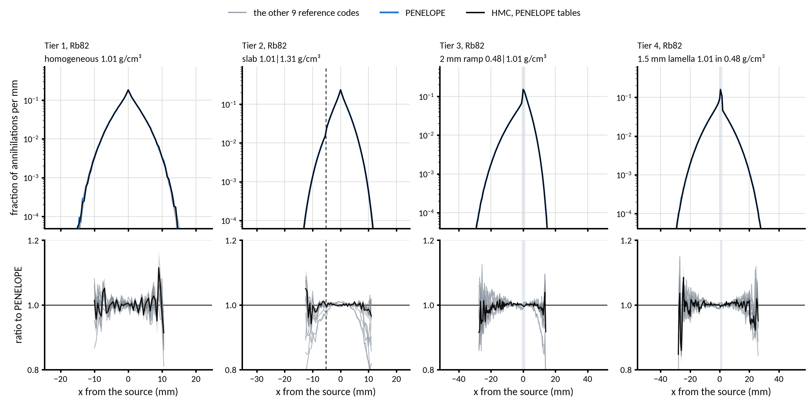
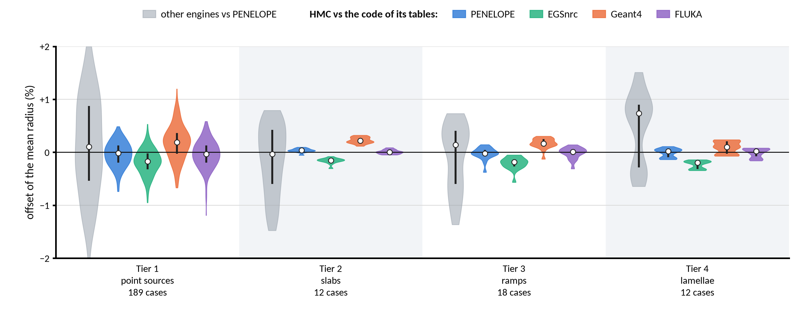
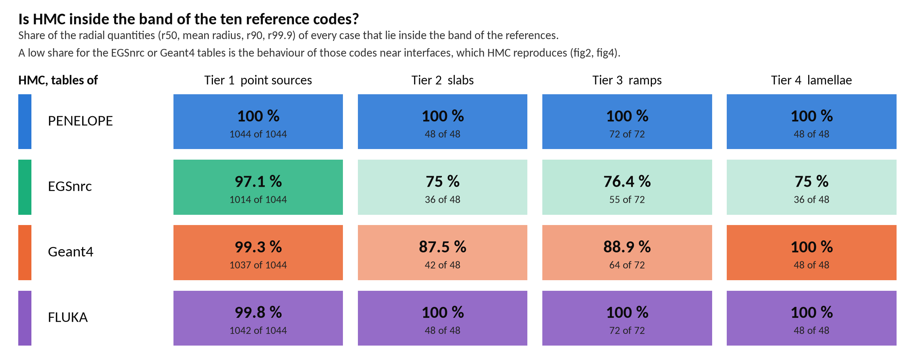
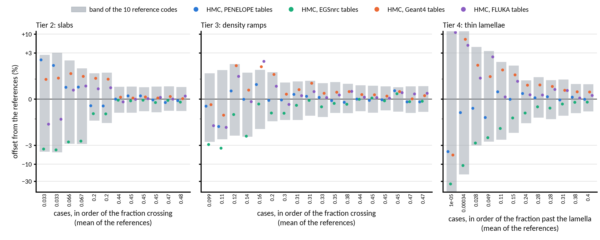
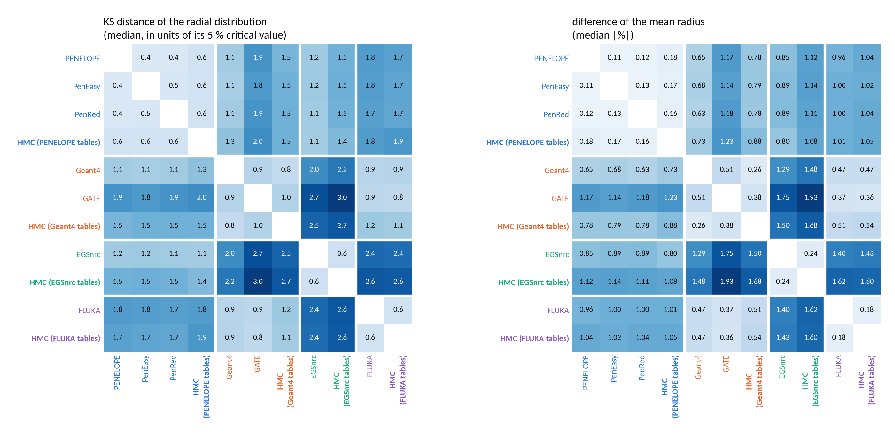
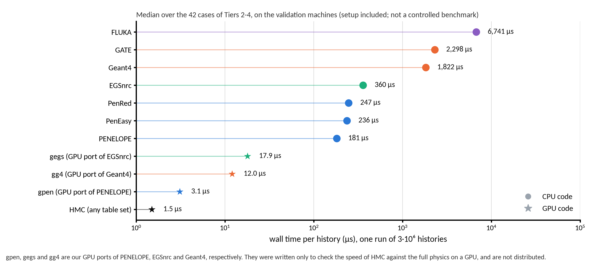

# HMC validation package

What HMC was checked against, the inputs of every check and the results, so that you can rerun any of it with the precompiled
`hmc/hmc.x` and look at the numbers yourself. The 305 cases are synthetic phantoms (points, slabs, ramps, lamellae of tissue
materials); there is no patient or animal data in this package.

HMC is compared with ten reference codes on the same case files: **PENELOPE** (a voxel program of ours, `pvoxel`, in the figures just
"PENELOPE") and **PenEasy**, **GATE** (OpenGATE 10.0.2 on Geant4), a voxel **Geant4** 11.3.2 application, **EGSnrc** v2025a, **PenRed**,
and **FLUKA** 4-5.2, plus three GPU ports, `gpen` (of PENELOPE), `gg4` (of Geant4) and `gegs` (of EGSnrc). The ports are ours and exist
only to validate HMC on a GPU: they run the full physics of their parent code on the same kind of hardware, so that the speed of HMC can
be compared like for like (fig6); they are not distributed. All ten transport the positron only, in the voxelised phantom,
from the same source and spectrum, with a 1 keV cutoff; electrons and photons are not transported. What each code is, with its
reference, is in `THIRD_PARTY_NOTICES.md` at the repository root. The "HMC variants" are `hmc.x` reading the PENELOPE, EGSnrc, Geant4
or FLUKA table set (`hmc_pen_lad`, `hmc_egs_lad`, `hmc_g4_lad`, `hmc_fl_lad`); they are kept out of the band of the references.

```
validation/
  cases/            44 case files (.npz) in one folder per tier (t0, t2, t3, t4): the material of every voxel, the source, the spectrum,
                    the specification.
                    The 261 cases of Tier 1 are homogeneous cubes and have no file: tools/make_hmc_inputs.py builds them from cases.csv
  materials.csv     the 30 tissue materials: k, nominal density, file name. The PENELOPE-format files (the input of PENELOPE, PenEasy,
                    PenRed and GATE/EGSnrc conversions) are materials/output/30mats/mat<k>.mat of the repository
  results/          cases.csv, qoi.csv, pairs.csv, envelope.csv: what every code gave for every case; profiles.csv and
                    interfaces.csv: the profile along x of four cases and the interface fractions of Tiers 2-4, per code
  examples/         reference_maps/: the PENELOPE annihilation map of six cases
  tools/            make_hmc_inputs.py, check_case.py, plot_results.py, metrics.py   (Python, numpy; matplotlib for the figures)
  figures/          six figures made from results/ by plot_results.py
```

## The cases

| tier | cases | what | purpose |
|---|---|---|---|
| 0 | 2 | F-18 and Ga-68 point sources in soft tissue, voxel 0.5 mm | conventions: emission at the voxel centre, one spectrum draw, escapes |
| 1 | 261 | point sources of 7 isotopes (F-18, Cu-64, Mn-52, Zr-89, Ga-68, I-124, Rb-82) and 18 mono-energetic ones (100 keV to 3 MeV) in a homogeneous cube of 6 tissues (density 0.11 to 1.84 g/cm³), voxel 0.25 to 3 mm | the positron range in every material; 10⁵ histories per seed |
| 2 | 12 | Rb-82 near a slab interface (soft/bone, lung/soft, lung/bone), source 0.25 or 5.25 mm from it, on either side | what an interface does to the cloud |
| 3 | 18 | the same with a graded transition of 2 or 7 mm (4 to 14 intermediate materials) | a density ramp instead of a step |
| 4 | 12 | F-18, Ga-68, Rb-82 next to a 0.5 or 1.5 mm lamella of soft tissue or bone in lung | thin dense structures |

Tiers 2 to 4 use 3·10⁶ histories per seed and a 0.5 mm voxel. Every case ran with three seeds. `results/cases.csv` has the
specification of each (grid, voxel, histories, geometry).

## The results

`results/qoi.csv`: one row per case and code (14 codes: the 10 references, the 4 HMC variants). The quantities are those of the
annihilation cloud around the source centre, measured to voxel centres: `r50_mm`, `r90_mm`, `r999_mm` (radii holding 50, 90 and
99.9 % of the annihilations), `rmean_mm` and its seed-to-seed `rmean_sigma_mm`, the widths `fwhm_mm`, `fwtm_mm`, `fw1pct_mm` of
the profile along x, `escaped_fraction` (positrons that left the grid or entered void), `centre_fraction`, `wall_s`
(seconds, on the validation machines: not a benchmark).

`results/envelope.csv`: the **band** of the references per case and quantity: `lo_mm`, `hi_mm` over the references, and `tol_mm`,
the larger of twice their statistical sigma, the seed-to-seed sigma and, for radial quantiles, half a voxel. A value is consistent
with the references when it lies in `[lo - tol, hi + tol]`. Tiers 2 to 4 also carry interface quantities (`iface_*`: the fraction of the
annihilations on each side, in each material, beyond the lamella).

`results/pairs.csv`: for every pair of codes the distance between their annihilation maps, `ks` (Kolmogorov-Smirnov distance of the
radial distributions, with its 5 % critical value `ks_crit_5pct`), `w1_mm` (1-Wasserstein), the voxel `chi2/ndf`, SSIM and the
relative differences of the quantiles.

`results/profiles.csv`: the annihilation profile along x (summed over y and z, the three seeds added) of one case per tier, for every
code: `x_mm` from the source, `counts`, `fraction_per_mm`. `results/interfaces.csv`: for the 42 cases of Tiers 2 to 4 and every code, the
fraction of the annihilations that crossed the interface (the side without the source; slabs and ramps) or got past the lamella, with
its binomial sigma.

## The figures

The six figures are made from the CSV files by `tools/plot_results.py` (`python validation/tools/plot_results.py`).

**fig1, profiles.** The profile of one case per tier (Rb-82: homogeneous, slab, ramp, lamella), HMC with the PENELOPE tables against the
ten references, and the ratio to PENELOPE underneath with its Poisson sigma. HMC follows PENELOPE through the interface and the
lamella within the statistics; where the reference codes differ from each other in the tails (slab), HMC stays with the PENELOPE family.



**fig2, fig3: HMC against one code and against all of them.** fig2 compares HMC with the code that made its tables (how well it reproduces
its source); fig3 asks whether HMC is inside the band of all ten references. They agree for the PENELOPE tables. For the EGSnrc and
Geant4 tables fig3 is lower because those codes are themselves at the edge of the band near interfaces.





**fig4, interfaces.** The fraction of the annihilations that crossed the interface (or got past the lamella), per case, as the offset from
the mean of the references: the grey bar is the band, the dots are the four HMC variants. The spread between the references grows as less
crosses; the EGSnrc tables sit at the low edge, the Geant4 tables at the high edge, the PENELOPE tables inside.



**fig5, distances between codes.** Each pair of the 11 codes (the three GPU ports are left out, they are twins of their parents): the median over the 305 cases of the KS distance of the radial distributions
(in units of its 5 % critical value) and of the difference of the mean radius. Every HMC variant lies next to its parent code, and the
codes fall into the families of their physics.



**fig6, speed.** Wall time per history of one run of 3·10⁶ histories (Tiers 2 to 4, median), setup included, on the machines the
validation ran on (CPU codes one run per core, GPU codes one GPU). The three GPU ports are the ones described at the top, made to compare HMC with the
full physics on a GPU. It is not a controlled benchmark: the hardware was not the same for all the codes.



What the tables say about HMC, share of the 4 radial quantities (r50, mean, r90, r99.9) inside the band, per tier
(`figures/fig3_hmc_in_band.png`):

| HMC reads the tables of | tier 1 | tier 2 | tier 3 | tier 4 |
|---|---|---|---|---|
| PENELOPE (the default) | 100 % | 100 % | 100 % | 100 % |
| FLUKA | 99.8 % | 100 % | 100 % | 100 % |
| Geant4 | 99.3 % | 87.5 % | 88.9 % | 100 % |
| EGSnrc | 97.1 % | 75.0 % | 76.4 % | 75.0 % |

All 1220 radial quantities of HMC with the PENELOPE tables (305 cases × 4) are inside the band. Against the code that made its
tables, HMC's mean radius differs by a median of −0.2 to +0.2 % in every tier and for every table set (935 cases with a cloud larger
than half a voxel: 99.8 % within 1 %, all within 1.2 %; `fig2`: PENELOPE tables −0.02 to +0.04 %, EGSnrc −0.20 to −0.15 %, Geant4 +0.10 to
+0.22 %, FLUKA +0.01 to +0.02 %). For scale, the other engines differ from PENELOPE by up to 2.3 % (5-95 %: −1.3 to +1.5 %). The
alternative table sets reproduce the physics of the code that made them, so against the band of all references together they leave
it more often near interfaces: each code has its own interface behaviour. The numbers are in `qoi.csv`; nothing is tuned. A case
whose reference mean radius is below half a voxel (a cloud that stays in the source voxel: coarse voxels, or 100 keV in 0.25 mm voxels)
has no meaningful relative offset and is left out of `fig2`.

## Using it: run a case and score it

From the repository root, with the tables unzipped (`luts/output/penelope`, see the main README):

```
python validation/tools/make_hmc_inputs.py t2_slab_Rb82_m12-m20_R5.25_dx0.50 --out work/slab
hmc/hmc.x --config work/slab/hmc.in
python validation/tools/check_case.py t2_slab_Rb82_m12-m20_R5.25_dx0.50 work/slab/annihilation.raw \
       --reference validation/examples/reference_maps/t2_slab_Rb82_m12-m20_R5.25_dx0.50.pvoxel.npz
```

A case is its id (the `id` column of `results/cases.csv`; for the 44 with a file, `validation/cases/t<tier>/<id>.npz` works too). `make_hmc_inputs.py` writes `density.raw`, `activity.raw`, `spectrum.txt` and `hmc.in` into `work/slab`: the density of each voxel is
the nominal density of its material (`materials.csv`), HMC derives the material itself from it. It takes `--tables
luts/output/geant4` (or `egsnrc`, `fluka`) to use another table set, `--nhist`, `--seed` and `--backend cpu|gpu|auto`. Edit `hmc.in`
to change any other key (the main README documents them).

`check_case.py` prints, for the quantities of the case, your value with its bootstrap sigma, the band of the references, what the
published HMC run gave and whether yours is in:

```
case t2_slab_Rb82_m12-m20_R5.25_dx0.50: 3e+06 histories, 3e+06 annihilated (0.000 % escaped); the band of 9 quantities ...
quantity                           this run         band of the references  published HMC  verdict
r50                         3.7417 ± 0.0000   [     3.4242,      3.9917]         3.7417  in
rmean                       4.0602 ± 0.0014   [     3.9982,      4.0618]         4.0605  in
...
against the pvoxel map: KS 0.0011 (5 % critical 0.0009), W1 0.0045 mm, voxel chi2/ndf 1.007, SSIM 1.00000
```

The exit status is 1 if a quantity is out of the band. With `--reference` it also compares your map with the PENELOPE map voxel by
voxel (six cases have one: `examples/reference_maps/`; every `.npz` there holds `map` (counts, the three seeds summed), `d_cm`,
`nhist`, `code`, `seeds`).

Other things to try with the same files:

- **Another table set or the CPU:** `--tables luts/output/egsnrc`, `--backend cpu`; compare with `check_case.py`.
- **Another isotope or material:** edit `spectrum.txt` (copy one of `hmc/input/spectra`) or `density.raw`; `tools/make_hmc_inputs.py`
  shows how the files are written (`write_raw`).
- **Read the tables yourself:** `results/*.csv` are plain CSV; `tools/plot_results.py` is a short example that builds the six figures
  from them.
- **Map-level comparisons:** `tools/metrics.py` has the radial quantiles with bootstrap, KS and Wasserstein distances, the voxel
  chi², SSIM and a 3D gamma, the way the validation scores maps.

## What is not here

The clinical and preclinical cases of the validation (patient scans and a mouse phantom) are not distributed, and neither are the
engines' sources and adapters; the numbers of the codes are, with their versions. FLUKA's results are published under its licence
for non-commercial scientific use (see `LICENSE`), with the references it requires:
https://fluka.cern/documentation/references.

## Licence and citation

This package (cases, results, figures, tools) is CC BY-NC 4.0, see `LICENSE`. Please cite HMC (see the main README) and the codes whose results you use.
